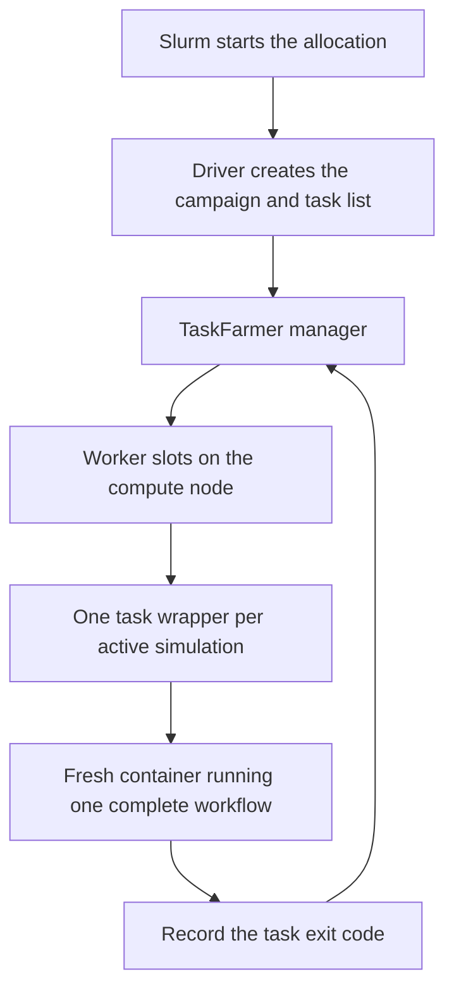

# Full test B: one container per simulation task

Upcoming in the next release: [full-b.sbatch](full-b.sbatch) runs a TaskFarmer campaign in which
every simulation task gets a fresh container. A task runs the entire physics chain inside that
container, then exits. TaskFarmer gives the freed worker slot another task until the list is exhausted.

The companion [C guide](README_c.md) describes the same workload using a shared container per worker node.

## What this test runs

| Setting | Value |
|---|---|
| Slurm submissions | One allocation |
| Nodes | Two CPU nodes: one TaskFarmer manager and one worker |
| QOS and account | `regular`, `m5464` |
| Walltime | Two hours, with an early TERM signal 120 seconds before the limit |
| CPU request | One Slurm task per node, with 256 hardware threads available to it |
| Simulation tasks | 100 internal-generator clasdis tasks |
| Events per simulation task | 5,000 requested events |
| Total requested events | 500,000 |
| Maximum active simulation tasks | `THREADS=100` per worker node by default |
| Container image | `ghcr.io/gemc/simgrid:test` by default |

The name `clasdis` comes from the existing test script. That script currently uses GEMC's internal
electron generator, with a 4 GeV beam and fixed 20-degree polar and azimuthal angles. It does not run
the external `clasdis` executable. These full tests do not use Lund input files.

`THREADS` counts active workflows, not events or Slurm submissions. Each workflow launches its own
GEMC and reconstruction processes sequentially. Applications can create additional internal threads.
TaskFarmer's worker slots do not impose separate per-workflow CPU or memory limits.

## Files and responsibilities

| File | Responsibility |
|---|---|
| [full-b.sbatch](full-b.sbatch) | Request the allocation and select layout B |
| [full-taskfarmer.sh](full-taskfarmer.sh) | Snapshot scripts, generate tasks, run TaskFarmer, count results |
| [full-task.sh](full-task.sh) | Prepare one task directory, launch its container, record its exit status |
| [container.sh](../../nersc_io/container.sh) | Stage the scripts and invoke `podman-hpc run` |
| [nodescript-clasdis.sh](nodescript-clasdis.sh) | Run the internal-generator physics chain |
| [functions.sh](../../generators/bash/functions.sh) | Module setup, timing, validation, and command wrappers |

Slurm manages the allocation. TaskFarmer manages the simulation task list. Podman-HPC provides the
container environment. These tests do not query the portal database or use the portal's priority systems.

## Submit on Perlmutter

Run these commands from this checkout's `tests/nersc` directory on a login node:

```shell
podman-hpc pull ghcr.io/gemc/simgrid:test
module load taskfarmer
mkdir -p full-b
sbatch full-b.sbatch
```

The image must be available before the allocation starts because the launcher uses `--pull=never`.
The compute node must have the JLab CVMFS repository and the shared CLAS12 modules. The host
`$HOME/.ssh` must contain the JLab `id_ed25519` key and `token-renew.zsh`, as described in the
[NERSC notes](../../NERSC.md). Each task uses these files to upload its final DST to JLab OSDF.

Slurm creates the `.out` and `.err` files before the batch script runs, so create `full-b/` before
submission. By default the batch script locates the checkout relative to the submission directory.
When submitting from elsewhere, set `SIMGRID_REPO_DIR` to the absolute checkout path and account for
the relative Slurm log paths.

The optional script argument selects an image already pulled on Perlmutter:

```shell
sbatch full-b.sbatch ghcr.io/gemc/simgrid:test
THREADS=20 sbatch full-b.sbatch
```

The driver accepts `THREADS` values from 1 through 128. Reducing concurrency does not change the
100-task workload or the two-node allocation. Increasing the node count with `sbatch --nodes=3`
provides another worker under TaskFarmer's manager/worker model; the same task list is distributed
across the workers. For the B/C comparison, use matching resources and concurrency.

## From submission to the task list



The batch script replaces itself with `full-taskfarmer.sh B <image>`. The driver creates
`$SCRATCH/simgrid/full-b/<job_id>/` and snapshots the clasdis node script, shared functions,
container launcher, and task wrapper. Editing the checkout afterward does not change those script
snapshots. The image and CVMFS software are not copied into the campaign.

The driver writes `config` with the layout and image reference, then generates `tasks.txt` with
100 commands. Each command invokes the snapshotted task wrapper with the campaign path, layout,
task ID, clasdis workflow, and image. The first assignments are:

| Task ID | Workflow | Input | GEMC seed |
|---|---|---|---|
| 0 | Internal generator | Generated inside GEMC | 100000 |
| 1 | Internal generator | Generated inside GEMC | 100001 |
| 2 | Internal generator | Generated inside GEMC | 100002 |
| 3 | Internal generator | Generated inside GEMC | 100003 |
| 99 | Internal generator | Generated inside GEMC | 100099 |

All IDs, from 0 through 99, are internal-generator tasks. The seed is `100000 + task_id`, matching
layout C. The test does not compare B and C outputs byte for byte.

The driver runs `runcommands.sh tasks.txt` from the campaign directory. TaskFarmer maintains its
queue and progress files there. A worker slot asks for another command whenever its current command
finishes. There are no fixed batches or barriers requiring the first 100 tasks to finish together.

## What happens for one task

1. `full-task.sh` creates `jobs/<task_id>/`, redirects stdout and stderr to task logs, and installs
   an exit trap. It exports the task ID and seed and selects the internal-generator node script.
2. It sources the snapshotted container launcher and calls `run_nersc_container` with 5,000 events.
3. The launcher copies `functions.sh` and the selected node script into the task directory. It
   mounts that directory at the same absolute path inside the container, mounts `/cvmfs` read-only
   when available, and mounts the host `.ssh` directory read-only at `/sshkeys`.
4. The launcher forwards Slurm metadata, `SCRATCH`, `CLAS12_*` settings, and the task ID and seed.
   It starts a fresh container with Bash running the staged node script.
5. The node script sources the shared functions, creates a unique `output-<job_id>-<suffix>` directory
   beneath the task directory, and changes into it before generating any physics files.
6. The node script runs the physics chain, renews its OSDF token, and uploads the final DST to JLab.
   There is no input-file download.
7. Its exit code propagates through Podman-HPC to the wrapper. The wrapper writes `exit-code` and
   a task timing/status line.
8. The container exits and `--rm` requests removal of its container instance. Files in the mounted
   task directory remain on scratch. TaskFarmer can assign another command to the worker slot.

At the default concurrency there can be up to 100 active containers on the worker node. A successful
first pass starts 100 containers in total; retries start additional containers. One container covers
all stages of each task, so reconstruction does not start a second container.

## Physics chain inside the container

```text
Internal electron generator -> GEMC -> gemc.hipo
                                           |
                              reconstruction -> recon.hipo
                                                    |
                                               HIPO test
                                                    |
                                         DST filter -> dst.hipo
                                                    |
                                      rename and validate final DST
                                                    |
                                       token renewal -> JLab upload
```

The shared setup verifies the configuration files and required modules. Defaults in `functions.sh`
select `gemc/dev`, `sqlite/dev`, `jdk/21.0.2`, and `coatjava/14.1.2`, with configuration tag `dev`,
detector configuration `highlumi_stage2`, and reconstruction YAML `mc-ai`. `CLAS12_*` environment
variables can override these settings before submission; keep them identical between B and C.

GEMC runs with `-N=5000`, the task's `-RANDOM` seed, the detector gcard, and both field scales set
to `-1.00`. The scripts require a nonempty `gemc.hipo`. They then unload the GEMC module, load Java
and coatjava, and invoke the CVMFS `recon-util` with the selected YAML and `-- -Xmx1920m`.
The Java heap limit is not the total memory used by a workflow. After successful reconstruction,
the scripts remove `gemc.hipo`.

`hipo-utils -test recon.hipo` checks the reconstructed file; the shared wrapper also requires at
least 100 bytes. The DST filter keeps the same banks as the OSG test: run and selected raw/scaler
banks, helicity information, reconstructed banks, selected Monte Carlo banks, and RICH results.
`create_dst` renames `dst.hipo`, tests the named DST, and removes `recon.hipo` after success.

These tests do not perform background merging or run a separate denoiser. The final DST remains
on NERSC scratch and is uploaded to JLab. Requesting 5,000 events is not an independent check
that the final file contains exactly 5,000 events.

Pelican uploads every task's final file to
`osdf:///jlab-osdf/clas12/volatile/osg/ungaro/test/full-b/<job_id>/<filename>.hipo`, corresponding to
`/volatile/clas12/osg/ungaro/test/full-b/<job_id>/` on JLab disk. All task HIPO files are directly
inside that job directory. A failed token renewal or upload makes the task fail.

## Outputs and monitoring

```text
tests/nersc/full-b/
    full-b-<job_id>.out                 Slurm stdout and campaign summary
    full-b-<job_id>.err                 Slurm stderr

$SCRATCH/simgrid/full-b/<job_id>/
    config                             Layout and image reference
    tasks.txt                          The 100 TaskFarmer commands
    scripts/                           Snapshotted scripts and shared functions
    progress.tasks.txt.tfin             TaskFarmer successful-task progress
    log.tasks.txt.tfin                  TaskFarmer errors
    jobs/<task_id>/
        task.out                       Appended task stdout and stage timing summaries
        task.err                       Appended task stderr
        exit-code                      Most recently recorded attempt status
        functions.sh                   Staged shared functions
        nodescript-<workflow>.sh        Staged node script
        output-<job_id>-<suffix>/       Physics working directory and final DST
```

For example, task 0 produces `clasdis-<job_id>-0.hipo` and task 1 produces
`clasdis-<job_id>-1.hipo`. TaskFarmer creates additional formatted-list, recovery,
and done files during execution. They belong with the original task list for restarts.

From the original submission directory:

```shell
job_id=123456  # Replace with the ID printed by sbatch.
campaign="$SCRATCH/simgrid/full-b/$job_id"
squeue -j "$job_id"
sacct -j "$job_id" --format=JobID,State,ExitCode,Elapsed,AllocCPUS
cat "full-b/full-b-$job_id.out"
cat "$campaign/jobs/0/task.err"
cat "$campaign/jobs/0/exit-code"
find "$campaign/jobs" -name '*.hipo' -type f
```

When TaskFarmer returns, the driver counts zero-valued `exit-code` files. It reports
`Completed: 100/100` only if all 100 status records indicate success. A nonzero TaskFarmer exit
code is preserved even if all task records say zero; fewer than 100 successful records also makes
the driver fail. Slurm accounting reports the allocation and steps, not 100 independently
submitted simulation jobs. Read the task logs to identify the failing physics stage.

The shared wrappers commonly report `204` for GEMC failure, `207` for reconstruction failure,
`208` for DST creation failure, `214` for HIPO integrity failure, and `215` for insufficient output
size. `run_timed` stops the chain on failure and removes intermediate data files, so failed tasks
may retain logs without retaining their partial HIPO files. A hard kill can prevent the exit trap
from writing a status file; a missing status is not a success.

## Interruption, restart, and comparison

The early TERM signal asks the driver to terminate its TaskFarmer process and exit with status 143.
It does not checkpoint GEMC or reconstruction or implement a drain period for active tasks.
Slurm ultimately controls termination of the allocation's processes.

To resume an interrupted campaign, retain its entire scratch directory and submit the same layout
and image reference with the original software settings:

```shell
SIMGRID_FULL_CAMPAIGN="$campaign" sbatch full-b.sbatch
```

Only one allocation should use a campaign directory at a time. The driver reuses the original
task list and script snapshots, checks the stored layout and image reference, and leaves the
TaskFarmer progress files intact. TaskFarmer uses those files to resume unfinished tasks. A
rerun task creates a new output subdirectory; task logs append, and its `exit-code` is replaced.
Completed outputs are not independently revalidated on restart. The scripts do not add a retry
count limit or automatically submit the next allocation.

A fresh submission without `SIMGRID_FULL_CAMPAIGN` creates a new campaign. For comparison with C,
keep image contents, software versions, event count, task count, concurrency, and node count fixed.
Compare successful tasks, failures, total elapsed time, and allocated node-hours. The printed
elapsed time spans TaskFarmer execution; it excludes queue wait, campaign preparation, and later
cleanup. Use Slurm accounting for allocation-wide time and include the manager node in the cost.

Each task log also prints the launch delay from wrapper startup to the container's worker script.
Its timing summary separates physics stages, token renewal, and Pelican upload. Compare those
components separately and repeat matching runs; a single total also includes variable network time.

Local mocked tests cover the command flow, task counts, and failure reporting. They do not measure
container startup cost or demonstrate that 100 full workflows fit and run efficiently on Perlmutter.
