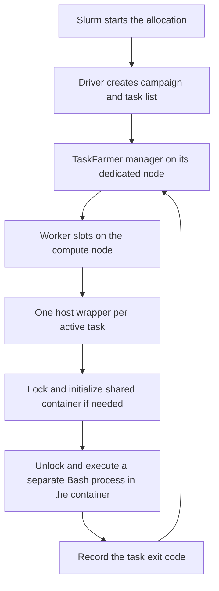

# Full test C: one shared container per worker node

Upcoming in the next release: [full-c.sbatch](full-c.sbatch) runs a TaskFarmer campaign in which
all simulation tasks assigned to a worker node execute in one shared container on that node.
The container stays alive between tasks. Each task starts a separate Bash process with its own
working directory, runs the entire physics chain, and returns its own exit status.

The companion [B guide](README_b.md) describes the same workload with a fresh container per task.

## What this test runs

| Setting | Value |
|---|---|
| Slurm submissions | One allocation |
| Nodes | Two CPU nodes: one TaskFarmer manager and one worker |
| QOS and account | `regular`, `m5464` |
| Walltime | Two hours, with an early TERM signal 120 seconds before the limit |
| CPU request | One Slurm task per node, with 256 hardware threads available to it |
| Simulation tasks | 100 internal-generator clasdis tasks |
| Events per simulation task | 5,000 requested events |
| Total requested events | 500,000 |
| Maximum active simulation tasks | `THREADS=100` per worker node by default |
| Container image | `ghcr.io/gemc/simgrid:test` by default |
| Active simulation containers | One per worker node that receives tasks |

The `clasdis` workflow currently uses GEMC's internal electron generator, not the external
`clasdis` executable. It requests 4 GeV electrons at fixed 20-degree polar and azimuthal angles.
These full tests do not use Lund input files. Both layouts use the same task IDs and seeds.

`THREADS=100` means up to 100 simultaneous workflows on each worker node. In C these are separate
process trees inside one container, not 100 containers or 100 Slurm jobs. Each workflow runs its
stages sequentially; GEMC and reconstruction from different tasks can run at the same time.
Application-internal threads and memory use must still fit the node. Sharing the container does
not merge the tasks' heaps or give each task a separate CPU or memory allowance.

## Files and responsibilities

| File | Responsibility |
|---|---|
| [full-c.sbatch](full-c.sbatch) | Request the allocation and select layout C |
| [full-taskfarmer.sh](full-taskfarmer.sh) | Prepare tasks, run TaskFarmer, count results, request cleanup |
| [full-task.sh](full-task.sh) | Manage the shared container, start one task process, record its result |
| [nodescript-clasdis.sh](nodescript-clasdis.sh) | Run the internal-generator physics chain |
| [functions.sh](../../generators/bash/functions.sh) | Module setup, timing, validation, and command wrappers |

TaskFarmer runs on the host and dispatches commands from a shared list. It does not run inside
the simulation container. The C branch of `full-task.sh` manages Podman-HPC directly; it does not
call the per-task `run_nersc_container` function or use Podman-HPC's `shared-run` launcher.

## Submit on Perlmutter

Run from this checkout's `tests/nersc` directory on a login node:

```shell
podman-hpc pull ghcr.io/gemc/simgrid:test
module load taskfarmer
mkdir -p full-c
sbatch full-c.sbatch
```

The compute nodes need JLab CVMFS and the shared CLAS12 modules. `$HOME/.ssh` must contain the
JLab `id_ed25519` key and `token-renew.zsh`, as described in the [NERSC notes](../../NERSC.md).
The C wrapper uses host `flock` to serialize shared-container startup and token initialization.
The image must already be pulled because startup uses `--pull=never`.

Create `full-c/` before submission because Slurm opens its log files before the script runs.
The batch script locates the checkout relative to the submission directory; set
`SIMGRID_REPO_DIR` explicitly if submitting from elsewhere, and account for the relative log paths.

An optional argument selects another already-pulled image. Concurrency can be reduced without
changing the campaign's task count:

```shell
sbatch full-c.sbatch ghcr.io/gemc/simgrid:test
THREADS=20 sbatch full-c.sbatch
```

The driver accepts `THREADS` from 1 through 128. With the default allocation there is one worker
node, so C normally starts one simulation container. If the allocation has additional workers,
each worker lazily creates its own container when it receives a task. TaskFarmer distributes the
same 100 commands across those workers. Use matching resources and settings when comparing with B.

## Campaign preparation and scheduling



The batch script replaces itself with `full-taskfarmer.sh C <image>`. The driver creates
`$SCRATCH/simgrid/full-c/<job_id>/`, snapshots the clasdis node script, shared functions, task wrapper,
and container launcher, and records the layout and image reference in `config`.
The container launcher is copied as part of the common preparation, but C does not invoke it.
The image and CVMFS software remain external to these script snapshots.

The generated `tasks.txt` has 100 commands, all using the internal generator. Task IDs run from 0
through 99. Every task receives the seed `100000 + task_id`, matching B. The wrapper always passes
5,000 events to the clasdis node script.

The driver launches `runcommands.sh tasks.txt` from the campaign directory. TaskFarmer provides
new work as slots become available and writes its progress files there. No fixed 100-task barrier
separates the workload into batches. Slurm sees the allocation and TaskFarmer's execution steps;
the individual simulations are TaskFarmer tasks, not separately submitted Slurm jobs.

## How the shared container is created

Every task wrapper first creates `jobs/<task_id>/`, redirects logs there, and installs an exit
trap that records the eventual status. For layout C it then follows this sequence:

1. Compute the container name `simgrid-full-<job_id>-<short_hostname>`. All tasks on the same
   worker node use that name; a different Slurm allocation gets a different name.
2. Open a lock file under `${TMPDIR:-/tmp}`, named with the job ID and host user ID, and acquire
   `flock` on file descriptor 9. The lock is local to that node.
3. Check `podman-hpc container exists <name>`. If the container is absent, start it with
   `podman-hpc run --detach --rm --pull=never --name <name> ...`.
4. The container's main process is Bash executing `sleep infinity`. This keeps the container
   alive; simulation processes are launched separately with `podman-hpc exec`.
5. Initialize the shared OSDF token if this container has no `token-ready` marker. Run
   `/sshkeys/token-renew.zsh` inside the container and require a nonempty bearer-token file before
   writing the marker. Creating a new container removes any marker left by an earlier instance.
6. Release `flock` and close descriptor 9 before starting the physics process.

The lock prevents two arriving tasks from creating the same container or initializing its token
simultaneously. It does not serialize the physics chain or uploads. Once startup is complete, many
`podman-hpc exec` calls run concurrently in the same container.

The container mounts the entire campaign directory at the same absolute path, `/cvmfs` read-only,
and the host `$HOME/.ssh` read-only at `/sshkeys`. It receives Slurm variables, `SCRATCH`,
`CLAS12_*` settings, and `SIMGRID_BACKEND=nersc` at startup. These mounts make the snapshotted
scripts and all task output directories visible to later `exec` calls.

## What is shared

There is no input-file download. Each clasdis node script reuses the token initialized under the
startup lock and uploads its final DST to JLab. `SIMGRID_TOKEN_READY=1` skips per-task renewal,
while each node script still requires a nonempty token file. This avoids concurrent renewal in
the shared writable home. The test assumes the token stays valid for the allocation; periodic
renewal is not implemented.

| Resource | Shared or separate? |
|---|---|
| Container image and writable container filesystem | Shared by that node's tasks |
| Container home, `/tmp`, and token location | Shared by that node's tasks |
| Campaign mount | Shared; each task uses its own subdirectory |
| Bash process and exported module environment | Separate for each `exec` invocation |
| GEMC and reconstruction process memory | Separate allocations, consuming the same node's RAM |
| Task logs, exit-code file, and physics working directory | Separate for each task |

Changing modules in one task's Bash process does not change another task's shell environment.
Programs that write fixed paths under a shared home or `/tmp` can still interfere; working-directory
isolation is not a separate container filesystem. That behavior is part of what must be checked
during the C benchmark on Perlmutter.

## Running a task inside the container

After releasing the lock, the wrapper runs `podman-hpc exec` with:

- `--workdir` set to `jobs/<task_id>/`.
- `SIMGRID_FUNCTIONS_FILE` pointing to the snapshotted shared functions.
- The task's `SIMGRID_TASK_ID` and `SIMGRID_TASK_SEED`.
- `SIMGRID_JLAB_OUTPUT_DIR` set to the full-c/job-ID upload directory.
- `SIMGRID_TASK_STARTED_AT` for launch-delay reporting and `SIMGRID_TOKEN_READY=1` for token reuse.
- A new Bash login-shell invocation running the snapshotted clasdis node script with 5,000 events.

The node script sources the shared functions, creates a unique `output-<job_id>-<suffix>` directory
under its task directory, and runs there. Each invocation has independent module setup and timing
arrays even though it uses the same container as other tasks. When the script exits, the `exec`
command returns that task's status; the sleeping main container process remains alive.

## Physics chain and final files

```text
Internal electron generator -> GEMC -> gemc.hipo
                                           |
                              reconstruction -> recon.hipo
                                                    |
                                               HIPO test
                                                    |
                                         DST filter -> dst.hipo
                                                    |
                                      rename and validate final DST
                                                    |
                                         shared token -> JLab upload
```

The clasdis node script uses the shared CVMFS setup and verifies the detector gcard and reconstruction
YAML. Defaults select `gemc/dev`, `sqlite/dev`, `jdk/21.0.2`, and `coatjava/14.1.2`, with tag `dev`,
detector configuration `highlumi_stage2`, and YAML `mc-ai`. `CLAS12_*` overrides must be set before
submission and match B's settings for a meaningful comparison.

GEMC uses `-N=5000`, the per-task `-RANDOM` seed, and field scales `-1.00`. The scripts require
a nonempty `gemc.hipo`, unload GEMC, load Java and coatjava, and run the CVMFS `recon-util` with
the selected YAML and `-- -Xmx1920m`. Each Java process has that heap limit; it is not a total
memory cap for the workflow or a shared heap across tasks. Successful reconstruction is followed
by deletion of `gemc.hipo`.

The reconstructed output must pass `hipo-utils -test` and the shared wrapper's 100-byte minimum.
The DST filter retains the same bank selection as the OSG test: run and selected raw/scaler banks,
helicity information, reconstructed banks, selected Monte Carlo banks, and RICH results. The
`create_dst` wrapper renames `dst.hipo`, tests the named final file, and removes `recon.hipo`.

There is no background-merging step or separate denoiser. The validated DST remains in its task's
scratch output directory and is uploaded to JLab. The requested event count is not an independent
verification that every final file contains exactly 5,000 events.

Pelican uploads every task's final file to
`osdf:///jlab-osdf/clas12/volatile/osg/ungaro/test/full-c/<job_id>/<filename>.hipo`, corresponding to
`/volatile/clas12/osg/ungaro/test/full-c/<job_id>/` on JLab disk. All task HIPO files are directly
inside that job directory. A failed token initialization or upload makes the task fail.

## Logs, status, and container cleanup

```text
tests/nersc/full-c/
    full-c-<job_id>.out                 Slurm stdout and campaign summary
    full-c-<job_id>.err                 Slurm stderr

$SCRATCH/simgrid/full-c/<job_id>/
    config                             Layout and image reference
    tasks.txt                          The 100 TaskFarmer commands
    scripts/                           Snapshotted scripts and shared functions
    progress.tasks.txt.tfin             TaskFarmer successful-task progress
    log.tasks.txt.tfin                  TaskFarmer errors
    containers/<hostname>/token-ready   Token initialized for this shared-container instance
    jobs/<task_id>/
        task.out                       Appended stdout and timing summaries
        task.err                       Appended stderr
        exit-code                      Most recently recorded attempt status
        output-<job_id>-<suffix>/       Physics working directory and final DST
```

C reads the node script and functions directly from the campaign snapshot. It does not stage
copies of them in each task directory as B does. For task 0, the named output is
`clasdis-<job_id>-0.hipo`; for task 1 it is `clasdis-<job_id>-1.hipo`.

From the original submission directory:

```shell
job_id=123456  # Replace with the ID printed by sbatch.
campaign="$SCRATCH/simgrid/full-c/$job_id"
squeue -j "$job_id"
sacct -j "$job_id" --format=JobID,State,ExitCode,Elapsed,AllocCPUS
cat "full-c/full-c-$job_id.out"
cat "$campaign/jobs/0/task.err"
cat "$campaign/jobs/0/exit-code"
find "$campaign/jobs" -name '*.hipo' -type f
```

The wrapper's exit trap records startup, physics, and upload failures as nonzero task outcomes when
it can run. Shared wrappers commonly return `204` for GEMC, `207` for reconstruction, `208` for
DST creation, `214` for HIPO integrity, and `215` for insufficient output size. Failure stops the
chain, and `run_timed` removes intermediate data files. Logs can therefore remain after partial
HIPO files have been removed. A hard kill can leave no exit-code record.

After TaskFarmer returns, the driver counts successful task records and prints the completed count
and elapsed seconds. It requires 100 zero-valued records and a successful TaskFarmer exit status.
It does not perform another HIPO scan at this point; validation happened in each workflow.

On driver exit, C attempts a cleanup `srun` with one process per allocated node. Each process
computes its local shared-container name, checks whether it exists, and asks Podman-HPC to stop
it with a ten-second grace period. `--rm` requests container removal after shutdown. Nodes that
never started a simulation container have nothing to stop. Cleanup errors are tolerated and do
not replace the campaign result.

The campaign files remain on scratch because they were bind-mounted outside the container.
Successful task completion alone does not stop the container; allocation-level cleanup does.

## Interruption and restart

The batch requests a TERM signal 120 seconds before walltime. The driver responds by signaling
its TaskFarmer process, exiting with status 143, and attempting the shared-container cleanup.
This is best-effort cleanup, not checkpointing or a guarantee that active tasks finish. A hard
kill or node failure can prevent cleanup. Any container inspection must run on the affected
compute node under an appropriate allocation; a login node's container list is not its list.

To resume, keep the whole campaign directory and use the original layout, image reference, and
software settings:

```shell
SIMGRID_FULL_CAMPAIGN="$campaign" sbatch full-c.sbatch
```

Use one allocation per campaign directory. The driver preserves the original task commands,
script snapshots, and TaskFarmer progress files. TaskFarmer resumes unfinished tasks. A new
Slurm job ID gives the shared container a new name. Creating it invalidates the old token marker
and initializes a new token before any tasks run.

Rerun tasks create new output subdirectories, append to their task logs, and replace their status
records. Previously completed DST files stay where they were created and keep their original job
ID in the filename. They are not automatically revalidated on restart. There is no added retry
limit or automatic submission of another allocation in these scripts.

## What to compare with B

Hold task count, event count, seeds, software, image contents, concurrency, and worker-node count fixed.
C avoids repeated container creation but shares writable container state and credentials between
tasks. It still starts a new shell and performs module setup for every task. B creates more
containers, while C shares the writable home and token location. The current end-to-end comparison
measures those lifecycle and credential differences together.

Compare successful tasks, failed tasks, total time, task timing summaries, memory use, and total
allocated node-hours including the manager. The printed elapsed time covers TaskFarmer execution;
campaign preparation, queue wait, and the later shared-container cleanup are outside that timer.
Use Slurm accounting to include the allocation's complete runtime.

Each task log prints its launch delay from wrapper startup to worker-script startup. This includes
shared-container startup, token initialization, and lock waits when needed. The stage summary
reports physics processing and Pelican upload separately. Repeat matching runs and compare those
components individually; network time can vary independently of container reuse.

Local mocked checks cover reuse of the container, event arguments, task counts, and error
propagation. Real concurrency, shared-file interactions, cleanup on Perlmutter, and performance
still need to be evaluated with the actual batch test.
